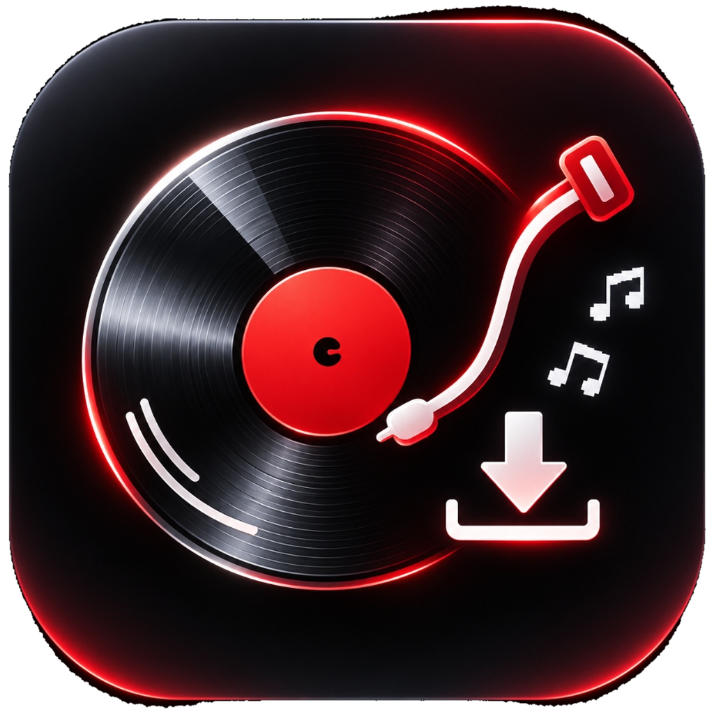
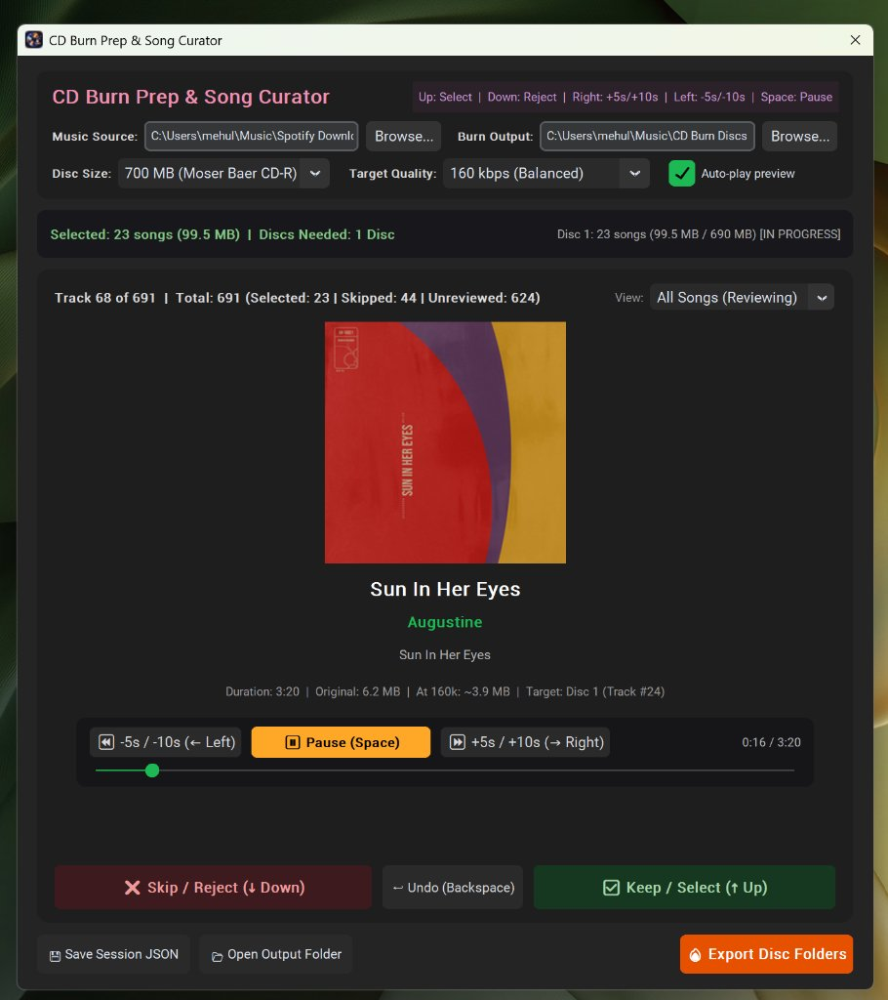
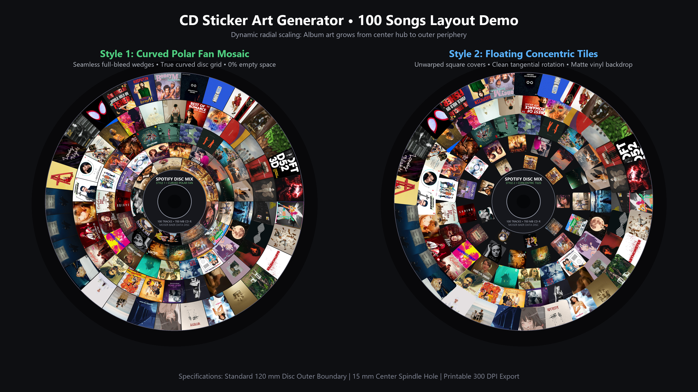

# Spotify Downloader

<p align="center">
  
</p>

<p align="center">
  <a href="#built-for-apple-music-itunes-and-ipods"></a>
  <a href="#built-for-apple-music-itunes-and-ipods"></a>
  <a href="#built-for-apple-music-itunes-and-ipods"></a>
  <a href="#cd-burn-preparation-and-smart-disc-splitting"></a>
  <a href="#cd-and-grid-art-studio-stickers-and-collages"></a>
</p>

A fast, modern desktop music downloader and library manager engineered specifically for **Apple Music, iTunes, and iPod users** as well as **physical CD burning enthusiasts**. Downloads entire Spotify playlists, albums, and tracks with **zero split albums** on iOS/iPods, embedded synchronized lyrics you can tap to read, pristine high-res album covers, and complete ID3 tags.

<p align="center">
  
</p>

---

## 1-Line Quick Install

Install and launch **Spotify Downloader** with a single command:

### Windows (PowerShell)
```powershell
irm https://raw.githubusercontent.com/mehuljain866/spotify-dl/main/install.ps1 | iex
```

### macOS / Linux (Terminal)
```bash
curl -fsSL https://raw.githubusercontent.com/mehuljain866/spotify-dl/main/install.sh | bash
```

---

## Single-File Standalone Downloads (No Python Required)

Prefer a portable single-file app without installing Python? Download from [**Latest Releases**](https://github.com/mehuljain866/spotify-dl/releases/latest):

| Platform | File | How to Run |
|----------|------|------------|
| **Windows** | `Spotify-Downloader-Windows.exe` | Double-click to run directly |
| **Linux** | `Spotify-Downloader-Linux` | `chmod +x Spotify-Downloader-Linux && ./Spotify-Downloader-Linux` |
| **macOS** | `Spotify-Downloader-macOS.zip` | Unzip and open `Spotify Downloader.app` |

---

## Built for Apple Music, iTunes, and iPods

Most generic music downloaders create major headaches when importing into iTunes, Apple Music, or syncing to an iPod. **Spotify Downloader** solves these issues out of the box:

- **Zero Split Albums (Unified Album Artist)**: On Apple Music and iPods, albums with guest features (e.g. Gorillaz feat. Snoop Dogg) notoriously splinter into multiple separate 1-song albums. Spotify Downloader automatically unifies the `Album Artist` tag (`TPE2` in MP3, `aART` in M4A) across every track so albums stay intact under one unified album card.
- **Embedded Synchronized Lyrics for iOS and iPod**: External `.lrc` files are completely ignored by Apple Music and iPods. Spotify Downloader queries LRCLIB and embeds lyrics directly into the audio metadata (`USLT` for MP3, `©lyr` for M4A). On your iPhone or iPod touch (iOS 7 through iOS 18), tap the album artwork while playing to reveal the synchronized lyrics overlay.
- **iPod-Optimized 640x640 Artwork**: Oversized, interlaced, or progressive cover images cause lag, memory crashes, or black squares on vintage click-wheel iPods (iPod Video 5th gen, Classic 6th/7th gen, iPod Nano). Every track receives a clean, standardized 640&times;640 baseline JPEG cover that loads instantly.
- **Official Apple Advisory Badges**: Injects iTunes `rtng` advisory metadata so your tracks display official `[E]` (Explicit) or `[Clean]` badges in Apple Music and iTunes.
- **100% Lossless Existing Library Fixer**: Already have a huge music folder plagued by split albums? Click **Fix Split Albums...** in the app or run `python spotify_dl.py --fix-tags "path/to/music"` to harmonize your entire collection in seconds without re-compressing the audio.

---

## Features

- **Blazing Fast Parallel Downloads**: Download up to 4 or 6 songs at the same time concurrently for up to 5x faster downloads. Configurable in the GUI and CLI.
- **iPod and Apple Music Ready**: Native embedded lyrics, unified Album Artist tags (no split albums), and iTunes advisory ratings out of the box.
- **Explicit vs Clean Radio Edit Modes**: Choose whether to download original uncensored tracks or official clean radio edits with profanities filtered from embedded lyrics.
- **Interactive CD Burn Prep & Song Curator**: Curate songs for burning onto standard 700 MB CD-Rs (Moser Baer) using keyboard arrow keys (Up = Keep, Down = Skip, Right = +5s/+10s, Left = -5s/-10s, Space = Pause/Play). Includes high-fidelity SDL2 playback, album art display, session JSON auto-saving, automatic disc splitting into Disc 1, Disc 2, Disc 3 folders, multi-threaded parallel export (`ThreadPoolExecutor`), and optional compression (192k/128k).
- **CD & Grid Art Studio (Sticker & Cover Generator)**: Generate high-resolution 300 DPI printable CD label stickers and album art collages directly from any music folder or curated disc folder. Supports three layout styles:
  1. *Curved Polar Fan Mosaic*: 100% full-bleed wedges curved along the CD radius and arc that scale smoothly from the center hub to the outer rim.
  2. *Floating Concentric Tiles*: Tangentially rotated unwarped square covers arranged in concentric rings over a sleek vinyl backdrop.
  3. *Any-by-Any Grid*: Auto-optimum or custom $R \times C$ grids for CD jewel case front covers (120x120mm), back tray inserts (150x118mm), posters, and wallpapers with custom tile spacing and corner rounding.
  Includes live interactive preview, custom center hub typography, 15mm/40mm spindle cutouts, cutting guides, 1:1 scale printable A4 sheets, and 1-click clipboard copy.
- **Synchronized Lyrics for Apple Music and iOS**: Automatically queries LRCLIB and embeds lyrics directly into ID3 tags (`USLT` for MP3, `©lyr` for M4A, `lyrics` for FLAC). On iOS 7+ and Apple Music, simply tap the album artwork on the player screen to view the lyrics. Companion `.lrc` files are also generated.
- **Hindi and Hinglish Lyrics Transliteration**: Choose between Romanized Hinglish (Hindi words in English alphabet for easy singing along), native Devanagari Hindi script, or unmodified database original. Built-in transliteration intelligently converts Devanagari lyrics and timestamps to Latin characters.
- **Official iTunes Advisory Badges**: Tags songs with Apple Music advisory ratings (`[E]` for Explicit uncensored and `[Clean]` for clean radio edits).
- **Consolidates Split Albums (Apple Music / iTunes)**: Prevents albums with guest singers (e.g. Gorillaz feat. Snoop Dogg) from splitting into multiple separate 1-song albums on Apple Music and iOS. Unifies `Album Artist` (`TPE2` / `aART`) while keeping individual track artist credits. Includes a 100% lossless repair tool for existing libraries.
- **Audio Downsizing and Storage Optimizer**: Downsize existing music files to 128k, 160k, or 192k to save massive storage space (up to 60% reduction) with a smart filter that only suggests bitrates lower than your current files. Preserves 100% of ID3 metadata and album art.
- **Simple and Clean UI**: Enter or paste a link, pick your folder, choose your settings, click **Start Download**, and watch real-time progress.
- **Desktop Shortcut**: Double-click the **Spotify Downloader** icon on your Desktop to launch directly without opening a terminal.
- **Unlimited Playlist Length**: Handles playlists with 100, 200, 500+ tracks automatically without capping or truncation.
- **Smart Incremental Sync**: Use the same folder again and again. If your playlist has 150 songs and you add 5 new ones, it skips the 145 existing songs in seconds and downloads only the new ones.
- **Embedded High-Resolution Album Art**: Injects 640×640 album artwork directly into every audio file.
- **Complete ID3 Tags**: Title, Lead Artist, Contributing/Featured Artists, Album, Track Number, Disc Number, and Release Date intact. Widely compatible with Windows Explorer, VLC, iTunes, Apple Music, and mobile players.
- **Zero Configuration**: No Spotify API key, developer account, or login required.
- **How It Works**: Queries Spotify and LRCLIB for official track metadata, album artwork, and synchronized lyrics, then fetches the matching audio stream via YouTube / YouTube Music using `yt-dlp`, encoding cleanly to your chosen format and bitrate (MP3 / M4A / FLAC).

---

## Running the Desktop App

1. **From your Desktop**: Double-click the **Spotify Downloader** shortcut.
2. **From Terminal**:
   ```powershell
   python gui.py
   ```

---

## Running via Command Line (CLI)

```powershell
# Download a playlist to a folder:
python spotify_dl.py https://open.spotify.com/playlist/<id> -o "C:\Music\MyPlaylist"

# Download with 4 parallel threads (default is 4x speed):
python spotify_dl.py https://open.spotify.com/playlist/<id> -o "C:\Music\MyPlaylist" --threads 4

# Incremental update (skips all existing tracks and downloads only new additions):
python spotify_dl.py https://open.spotify.com/playlist/<id> -o "C:\Music\MyPlaylist"

# Download a single track:
python spotify_dl.py https://open.spotify.com/track/4cOdK2wGLETKBW3PvgPWqT -o "C:\Music"

# Download clean radio edit versions with embedded lyrics:
python spotify_dl.py https://open.spotify.com/playlist/<id> -o "C:\Music\MyPlaylist" --explicit-mode clean

# Downsize all songs in a folder to save storage (e.g. 192k or 128k):
python spotify_dl.py --downsize "C:\Music\MyPlaylist" --bitrate 192k

# Fix fragmented/split albums for Apple Music and iTunes:
python spotify_dl.py --fix-tags "C:\Music\MyPlaylist"

# Update an existing music folder to Clean radio edits and embed lyrics:
python spotify_dl.py --update-explicit "C:\Music\MyPlaylist" --explicit-mode clean
```

### CLI Options

| Flag | Description | Default |
|------|-------------|---------|
| `-o`, `--output` | Destination folder for downloads | `~/Music/Spotify Downloads` |
| `-t`, `--threads` | Number of parallel song downloads | `4` |
| `--format` | Output audio format (`mp3`, `m4a`, `flac`, `opus`, `wav`) | `mp3` |
| `--bitrate` | Audio bitrate (`128k`, `160k`, `192k`, `256k`, `320k`) | `320k` |
| `--explicit-mode` | Audio version: `explicit` (uncensored) or `clean` (radio edit) | `explicit` |
| `--no-lyrics` | Do not fetch or embed lyrics into audio files | `False` |
| `--lyrics-script` | Preferred script for Hindi lyrics (`hinglish`, `devanagari`, `original`) | `hinglish` |
| `--force` | Re-download songs even if already present | `False` |
| `--limit` | Limit download to first N tracks | `None` (all) |
| `--downsize` | Downsize/transcode all songs in a folder to target bitrate | `None` |
| `--fix-tags` | Fix fragmented albums for iTunes/Apple Music by unifying Album Artist | `None` |
| `--update-explicit` | Update existing songs in a folder to Explicit or Clean audio/lyrics | `None` |
| `--no-redownload` | When updating explicit mode, only update tags/lyrics without re-downloading audio | `False` |
| `--cd-prep` | Launch interactive CD Burn Prep & Song Curator tool | `False` |

---

## Explicit vs Clean Audio and Lyrics Management

Spotify Downloader gives you full control over whether to download uncensored explicit tracks or radio edits, and automatically embeds synchronized lyrics into your files for Apple Music and iOS.

<p align="center">
  
</p>

### Downloading Explicit or Clean Songs

1. **In the Desktop App**:
   - In **Download Settings**, select **Audio Version**:
     - **Explicit (Uncensored)**: Downloads the original uncensored audio stream and unabridged lyrics.
     - **Clean (Radio Edit)**: Downloads the official radio edit audio stream and automatically censors profanities in the embedded lyrics.
   - Keep **Embed lyrics into songs (Apple Music / iOS)** checked to automatically embed lyrics (`USLT` for MP3, `©lyr` for M4A, `lyrics` for FLAC) and companion `.lrc` files.
   - On iOS 7+ and Apple Music, tapping the album artwork on the player screen instantly displays the embedded lyrics.

2. **In the Terminal (CLI)**:
   ```powershell
   # Download clean radio edit version with lyrics:
   python spotify_dl.py https://open.spotify.com/playlist/xxx --explicit-mode clean

   # Download explicit uncensored without embedding lyrics:
   python spotify_dl.py https://open.spotify.com/playlist/xxx --explicit-mode explicit --no-lyrics
   ```

### Updating Existing Songs in Your Library

If you already downloaded songs and want to switch them between Explicit and Clean versions, or embed missing lyrics:

1. **In the Desktop App**:
   - In the **Download Folder** card, click **Explicit & Lyrics...**.
   - Choose your **Target Version** (`Clean (Radio Edit)` or `Explicit (Uncensored)`).
   - Check **Re-download audio when version differs** to swap explicit audio for clean radio edit audio (or vice-versa) while keeping album artwork and metadata intact.
   - Check **Fetch & embed lyrics into song tags** to fetch lyrics and embed them into the files.
   - Click **Start Updating Library**.

2. **In the Terminal (CLI)**:
   ```powershell
   # Convert all existing library songs to Clean radio edits and embed lyrics:
   python spotify_dl.py --update-explicit "C:\Users\mehul\Music\Spotify Downloads" --explicit-mode clean

   # Only update tags and lyrics without re-downloading audio streams:
   python spotify_dl.py --update-explicit "C:\Users\mehul\Music\Spotify Downloads" --explicit-mode explicit --no-redownload
   ```

### Lyrics on Apple Music and iOS

- **Format Support**: Embedded into ID3 tags via `USLT` (Unsynchronized Lyrics) for MP3, `©lyr` for M4A, and `lyrics` for FLAC.
- **How to View on iPhone**: Open the Music app on your iPhone or iPod (iOS 7.1.2 through iOS 18), start playing a song, and tap once on the large album cover art on the player screen. The lyrics will overlay seamlessly over the cover.
- **Companion `.lrc`**: A timestamped `.lrc` file is also created alongside each song for third-party media players that support synchronized karaoke-style scrolling lyrics.

### Hindi and Hinglish Lyrics Preference

When downloading Bollywood or Hindi songs, lyrics in online databases are frequently in Devanagari script (e.g. `नैना थके थके`), making it difficult to sing along if you prefer reading the Roman/English alphabet:

- **Hinglish (English Letters)** *(Default)*: Automatically converts Devanagari Hindi text to Romanized Hinglish (e.g. `naina thake thake, palaken bujhi bujhi`) while preserving timestamps and punctuation.
- **Hindi (Devanagari Script)**: Preserves native Devanagari script.
- **Original (Database Default)**: Retains whatever script is returned directly by the lyrics provider.

Configure this in the **Hindi Lyrics Script** dropdown under Download Settings or in the **Explicit & Lyrics Manager** dialog. Via CLI:
```powershell
# Download with Hinglish transliteration (default):
python spotify_dl.py https://open.spotify.com/playlist/<id> --lyrics-script hinglish

# Update existing library to Hinglish lyrics:
python spotify_dl.py --update-explicit "C:\Users\mehul\Music\Spotify Downloads" --lyrics-script hinglish --no-redownload
```

---

## Apple Music and iTunes Album Grouping (Fix Split Albums)

If you download an album with featured guest artists (such as Gorillaz' *Plastic Beach* featuring Snoop Dogg, Bobby Womack, or Little Dragon) and sync it to Apple Music or iOS, the album may appear "fragmented" across your library as multiple separate album tiles with 1 or 2 songs each.

### Why Albums Split in Apple Music

Apple Music and iOS organize albums by the **Album Artist** tag (`TPE2` in MP3, `aART` in M4A, `albumartist` in FLAC). If an album only has the individual track artist filled in (e.g. `Gorillaz feat. Snoop Dogg`) and the Album Artist is blank or inconsistent, Apple Music treats every unique guest combination as a completely different album.

### How Spotify Downloader Solves This

- **Automatic for New Downloads**: All new downloads automatically set the primary artist as the unified `Album Artist` while preserving the full guest list in the song title and artist tags.
- **100% Lossless Consolidation for Existing Music**:
  - **In the Desktop App**: In the Download Folder card, click **Fix Split Albums...** and click **Scan & Fix Album Tags**.
  - **In the Terminal (CLI)**:
    ```powershell
    python spotify_dl.py --fix-tags "C:\Users\mehul\Music\Spotify Downloads"
    ```
  - This scans your music files and harmonizes the `Album Artist` tag across all tracks belonging to the same album. The audio stream is not transcoded or re-compressed; only the ID3 grouping tags are updated.

### Syncing to iPhone and iOS Devices

After downloading or running the album consolidation tool:
1. Open iTunes or Apple Music on your computer.
2. If the files were already in your iTunes library, right-click the songs and choose **Get Info**, then click **OK** to let iTunes refresh its tag cache.
3. Sync your iPhone or iPod. All songs will now appear grouped together under a single, unified album cover.

---

## Downsizing and Audio Quality Adjustment

If your music library occupies too much storage space (e.g. downloaded at 320 kbps), you can easily downsize your existing music files:

<p align="center">
  
</p>

1. **In the Desktop App**:
   - In the **Download Folder** card, click **Downsize Quality...**.
   - The app automatically inspects the actual encoding of all songs in the folder and presents only valid, reducible bitrate options along with calculated storage savings (e.g. `192k saves ~25% [~948 MB]`, `128k saves ~50% [~1.85 GB]`).
   - Select whether to replace files in-place or output to a separate subfolder.
   - Click **Start Downsizing** — all album art, ID3 tags, and artist info are preserved intact.

2. **In the Terminal (CLI)**:
   ```powershell
   python spotify_dl.py --downsize "C:\Users\mehul\Music\Spotify Downloads" --bitrate 192k
   ```

> **Note on Upgrading Audio Quality**: Re-encoding lower-bitrate audio files to higher bitrates cannot restore lost frequencies. To truly upgrade lower-bitrate tracks to maximum quality (e.g. 320 kbps), check **Overwrite existing tracks (force re-download)** in the main window and click **Start Download** — Spotify Downloader will re-fetch the best available source streams via YouTube / YouTube Music matched against official Spotify metadata.

---

## CD Burn Preparation and Smart Disc Splitting

If you have a large library of downloaded songs and want to burn them onto standard 700 MB CD-Rs (such as Moser Baer white discs) or DVDs, Spotify Downloader includes an interactive "Tinder-style" curation and smart disc-splitting tool:

<p align="center">
  
</p>

### Keyboard Curation Controls

- **Up Arrow**: **Keep / Select** the current song for CD burning.
- **Down Arrow**: **Skip / Reject** the current song.
- **Right Arrow**: Fast-forward audio seek:
  - **Single-tap**: advance forward **5 seconds**.
  - **Double-tap**: advance forward **10 seconds**.
- **Left Arrow (Back)**: Rewind audio seek:
  - **Single-tap**: rewind **5 seconds**.
  - **Double-tap**: rewind **10 seconds**.
- **Spacebar**: **Play / Pause** toggle.
- **Backspace or Z**: **Undo** the last decision and step back.
- **P**: Quick play/pause toggle.

### Smart Disc Packing and Exporting

1. **In the Desktop App**:
   - In the **Download Folder** card, click **CD Burn Prep...**.
   - Review your songs one by one with album artwork, title, artist, duration, and original/compressed file size.
   - Choose your **Target Quality** (e.g. `192 kbps` fits ~145-150 songs per disc, `128 kbps` fits ~215-220 songs per disc, or `Original`).
   - The live status bar calculates your total disc requirements in real time as you make decisions (e.g. `Disc 1: 98 songs (688 MB / 690 MB) [FULL] | Disc 2: ...`).
   - Your progress is automatically saved to `cd_curation_session.json` so you can close and resume anytime without losing your selections.
   - Click **Export Disc Folders** to generate dedicated `Disc 1/`, `Disc 2/`, `Disc 3/` folders complete with track numbering (`01 - Artist - Title.mp3`), `playlist.m3u`, and `disc_tracklist.txt`.
   - Burn each disc folder directly using Windows Media Player, ImgBurn, CDBurnerXP, or Nero!

2. **In the Terminal (CLI)**:
   ```powershell
   python spotify_dl.py --cd-prep
   ```

---

## CD and Grid Art Studio (Stickers and Collages)

Once your songs are curated or burned, generate high-resolution printable circular CD stickers (120 mm) or square/rectangular artwork collages with the built-in **CD & Grid Art Studio**:

<p align="center">
  
</p>

<p align="center">
  <br />
  <em>Real-world result: 1:1 true-to-scale printed CD sticker loaded into a physical CD player tray.</em>
</p>

### Layout Styles

- **Style 1: Curved Polar Fan Mosaic (CD Disc)**:
  - 100% full-bleed coverage with zero blank space.
  - Mathematically maps each album cover into an annular wedge curving along the circular disc radius.
  - Dynamically scales cells from compact near the center spindle to large at the outer rim.
- **Style 2: Floating Concentric Tiles (CD Disc)**:
  - Preserves original unwarped square album cover aspect ratios.
  - Arranged in concentric rings rotated tangentially around the center hub over a sleek dark vinyl backdrop.
  - Scales tile dimensions smoothly from inner hub to outer perimeter.
- **Style 3: Any-by-Any Grid (Jewel Case Inserts and Posters)**:
  - **Auto-Optimum Grid**: Automatically calculates the most balanced square/rectangular grid for your song count (e.g. 100 songs &rarr; 10&times;10).
  - **Custom Dimensions**: Enter any custom Rows &times; Columns.
  - **Presets**: Standard CD Jewel Case Front Insert (120&times;120 mm), Back Tray Insert (150&times;118 mm), Desktop Wallpaper (16:9), and Poster (3:4).
  - Configurable tile spacing (gap) and corner rounding sliders.

### Center Hub and Print Features

- **Intelligent Album Deduplication**: Automatically detects multiple songs from the same album or identical embedded artwork and shows each album cover exactly once without repetitive clutter (includes a live toggle to view unique albums vs all tracks).
- **Custom Typography**: Add custom Disc Title, Subtitle, and extra notes (e.g. track count, date, brand) directly in the center hub.
- **Spindle Sizing**: Choose between Small Spindle (15-20 mm full-coverage sticker) or Standard Hub (40 mm clear center ring).
- **Physical Scale (300 DPI)**: Export 1:1 physical scale printable A4 sheets with alignment crosshairs ready for sticky paper, or copy directly to clipboard.
