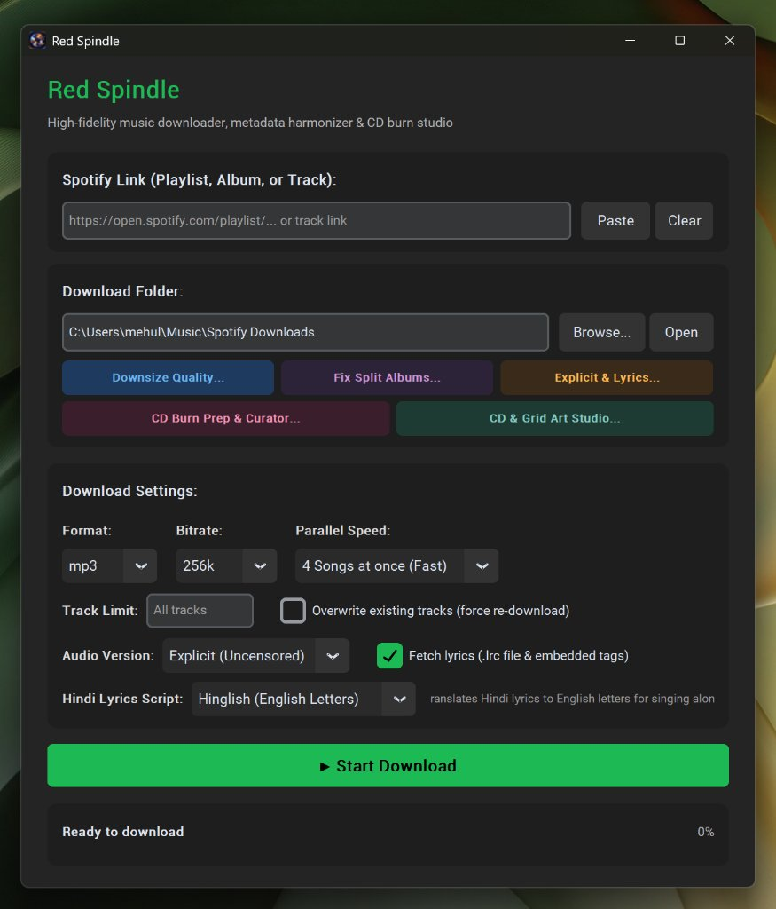
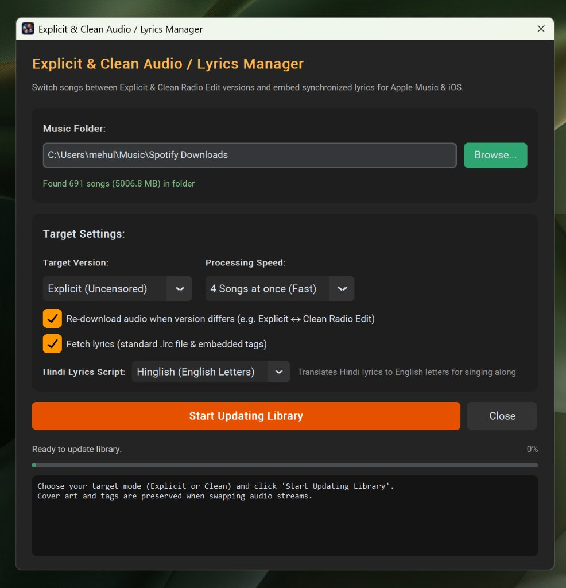
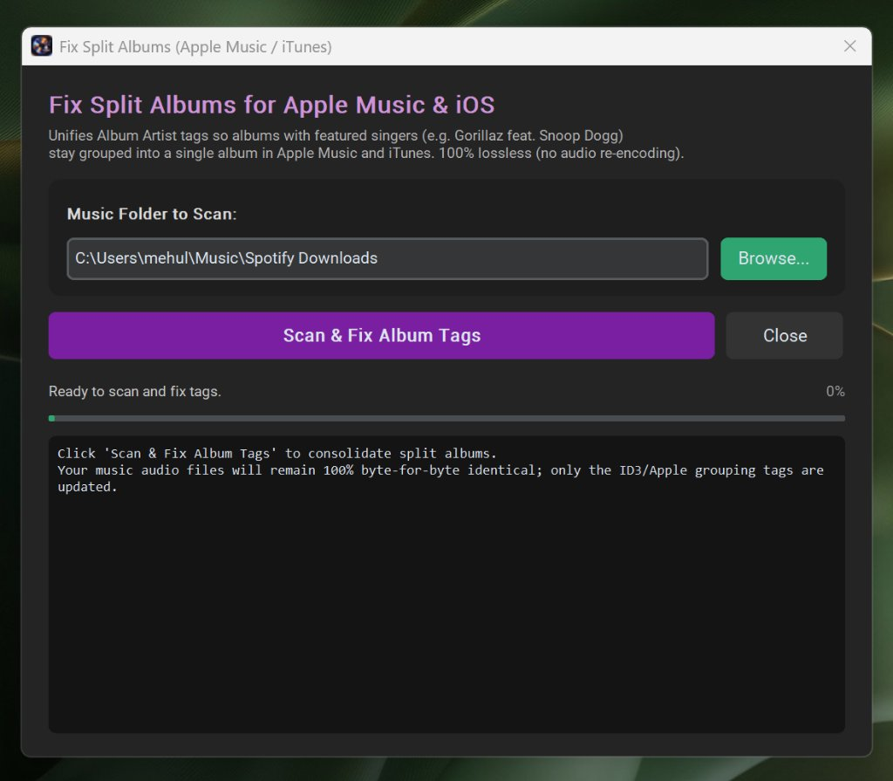
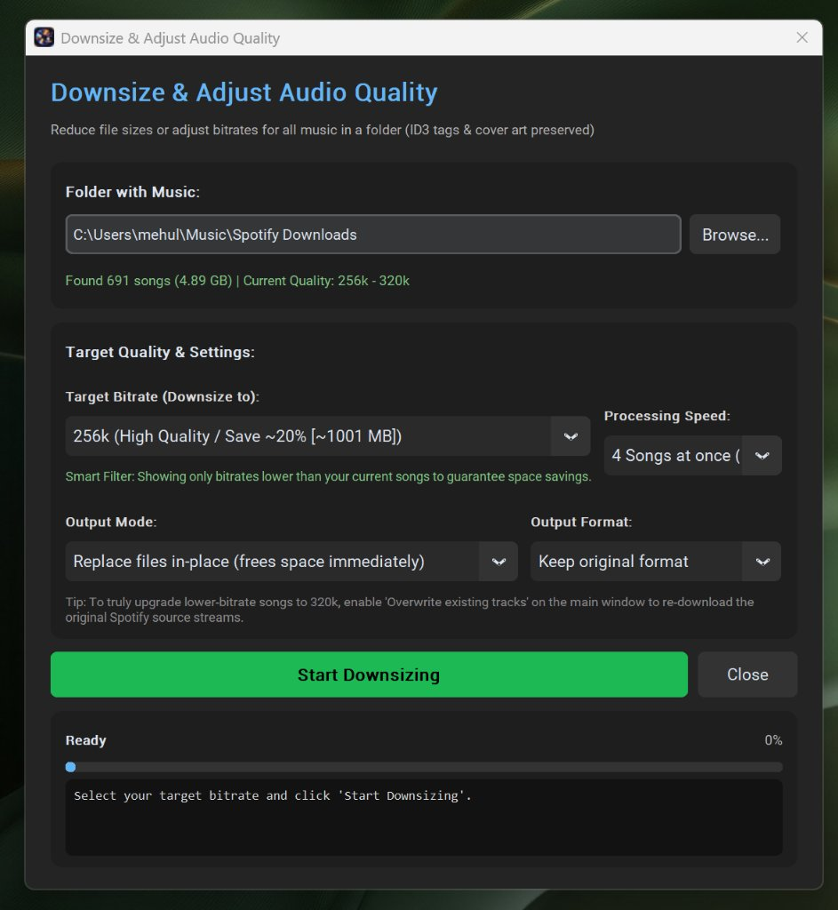
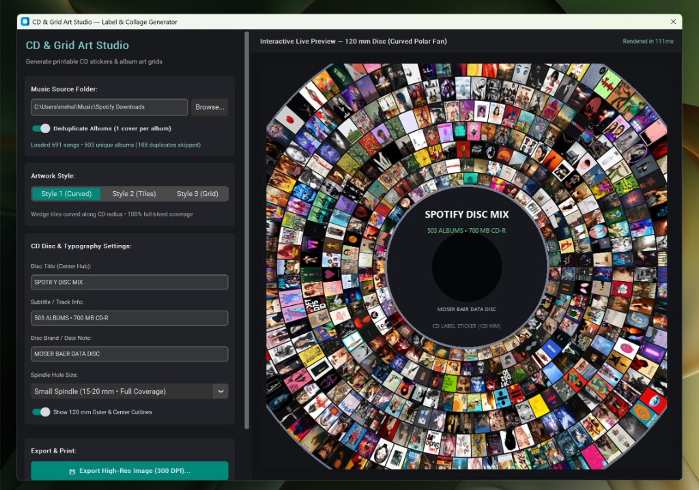
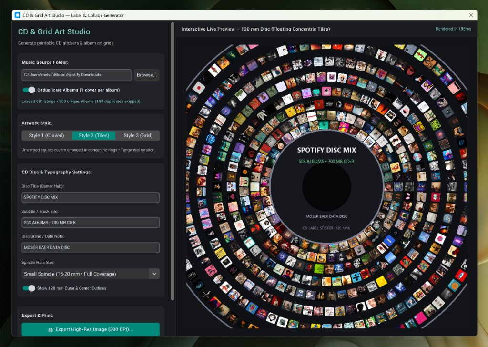
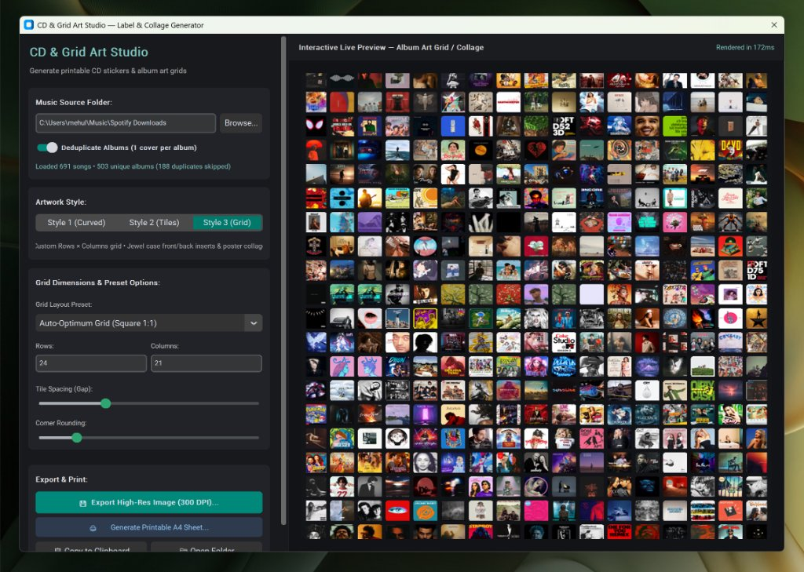
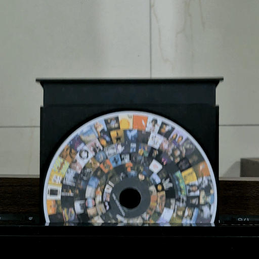

# Red Spindle

<p align="center">
  
</p>

<p align="center">
  <a href="#library-tagging-and-player-compatibility"></a>
  <a href="#library-tagging-and-player-compatibility"></a>
  <a href="#library-tagging-and-player-compatibility"></a>
  <a href="#cd-burn-preparation-and-smart-disc-splitting"></a>
  <a href="#cd-and-grid-art-studio-stickers-and-collages"></a>
</p>

Downloads Spotify playlists, albums, and tracks with ID3 metadata, album artwork, and synchronized lyrics. Generates standard `.lrc` files and embedded tags, prevents split albums across media libraries, curates songs for 700 MB Data/MP3 CDs and 80-minute Audio CDs, and creates 1:1 scale printable disc stickers.

<p align="center">
  
</p>

---

## 1-Line Quick Install

Install and launch **Red Spindle** with a single command:

### Windows (PowerShell)
```powershell
irm https://raw.githubusercontent.com/mehuljain866/redspindle/main/install.ps1 | iex
```

### macOS / Linux (Terminal)
```bash
curl -fsSL https://raw.githubusercontent.com/mehuljain866/redspindle/main/install.sh | bash
```

---

## Single-File Standalone Downloads (No Python Required)

Prefer a portable single-file app without installing Python? Download from [**Latest Releases**](https://github.com/mehuljain866/redspindle/releases/latest):

| Platform | File | How to Run |
|----------|------|------------|
| **Windows** | `RedSpindle-Windows.exe` | Double-click to run directly |
| **Linux** | `RedSpindle-Linux` | `chmod +x RedSpindle-Linux && ./RedSpindle-Linux` |
| **macOS** | `RedSpindle-macOS.zip` | Unzip and open `Red Spindle.app` |

---

## Library Tagging and Player Compatibility

Most media players (including Windows Media Player, Apple Music, iTunes, and mobile apps) organize collections using metadata tags. Red Spindle structures tags to avoid common grouping and display issues:

- **Unified Album Artist (Prevents Split Albums)**: When songs feature guest artists (for example, *Gorillaz feat. Snoop Dogg*), media players lacking a unified `Album Artist` tag (`TPE2` in MP3, `aART` in M4A) separate the release into multiple 1-song albums. Red Spindle sets a consistent `Album Artist` while preserving track-level performer credits.
- **Dual-Layer Lyrics (.lrc and Embedded Tags)**: Standard players read external `.lrc` files, while closed players (like Apple Music and car stereos) only read internal container tags (`USLT` for MP3, `©lyr` for M4A). Red Spindle provides both.
- **Hardware-Compatible 640x640 Artwork**: Progressive or oversized JPEG encodings cause decoding lag and memory errors on older hardware players, classic click-wheel iPods, and in-car systems. Covers are encoded as standard 640&times;640 baseline JPEGs.
- **Content Advisory Badges**: Adds `rtng` metadata so explicit and clean radio tracks display `[E]` or `[Clean]` tags in supporting players.
- **Library Tag Repair (Dry Run & Safety Snapshots)**: Use **Fix Split Albums...** in the app or run `python spotify_dl.py --fix-tags "path/to/music"`. Scans nested directories recursively, isolates distinct albums sharing identical titles (such as *Greatest Hits*) using multi-factor clustering, simulates changes in advance with `--dry-run`, and creates an automated `.json` tag backup snapshot before modifying files.

---

## Features

- **Parallel Downloads**: Downloads 4 to 6 songs concurrently. Configurable in GUI and CLI.
- **Universal Library & Tag Standards**: Native embedded lyrics, companion .lrc sidecars, unified Album Artist tags (prevents split albums), and standard content advisory metadata.
- **Explicit vs Clean Radio Edit Modes**: Choose whether to download original uncensored tracks or official clean radio edits with profanities filtered from embedded lyrics.
- **Interactive CD Burn Prep & Song Curator**: Curate songs for burning onto physical media (700 MB Data/MP3 CDs or 80-minute Red Book Audio CDs) using keyboard arrow keys (Up = Keep, Down = Skip, Right = +5s/+10s, Left = -5s/-10s, Space = Pause/Play). Includes SDL2 playback, album art display, session auto-saving, automatic disc splitting into Disc 1, Disc 2, Disc 3 folders, multi-threaded export (`ThreadPoolExecutor`), and optional compression (192k/128k).
- **CD & Grid Art Studio (Sticker & Cover Generator)**: Generate 300 DPI printable CD label stickers and album art collages directly from any music folder or curated disc folder. Supports three layout styles:
  1. *Curved Polar Fan Mosaic*: Full-bleed wedges curved along the CD radius and arc that scale from the center hub to the outer rim.
  2. *Floating Concentric Tiles*: Tangentially rotated unwarped square covers arranged in concentric rings over a dark circular background.
  3. *Any-by-Any Grid*: Auto-optimum or custom $R \times C$ grids for CD jewel case front covers (120x120mm), back tray inserts (150x118mm), posters, and wallpapers with custom tile spacing and corner rounding.
  Includes interactive live preview, custom center hub typography, 15mm/40mm spindle cutouts, cutting guides, 1:1 scale printable A4 sheets, and 1-click clipboard copy.
- **Synchronized Lyrics (.lrc and Embedded Tags)**: Fetches synced lyrics from LRCLIB and writes standard timestamped `.lrc` files alongside each song for players that read sidecar files (Android apps, desktop players, DAPs). Also embeds lyrics into metadata tags (`USLT` for MP3, `©lyr` for M4A, `lyrics` for FLAC) for closed players like Apple Music and car stereos.
- **Hindi and Hinglish Lyrics Transliteration**: Choose between Romanized Hinglish (Hindi words in English alphabet for easy singing along), native Devanagari Hindi script, or unmodified database original. Built-in transliteration intelligently converts Devanagari lyrics and timestamps to Latin characters.
- **Content Advisory Ratings**: Writes standard advisory metadata (`[E]` for explicit uncensored, `[Clean]` for radio edits) recognized by mobile and desktop players.
- **Consolidates Split Albums**: Prevents albums with guest artists (e.g. Gorillaz feat. Snoop Dogg) from splitting into multiple separate 1-song albums across media libraries. Unifies `Album Artist` (`TPE2` / `aART`) while keeping individual track artist credits. Includes a lossless repair tool for existing libraries.
- **Audio Downsizing**: Converts existing library tracks to 128k, 160k, or 192k to reduce file size while preserving ID3 tags and album artwork. The selector only lists bitrates lower than your source files.
- **Simple and Clean UI**: Enter or paste a link, pick your folder, choose your settings, click **Start Download**, and watch real-time progress.
- **Desktop Shortcut**: Double-click the **Red Spindle** icon on your Desktop to launch directly without opening a terminal.
- **Unlimited Playlist Length**: Handles playlists with 100, 200, 500+ tracks automatically without capping or truncation.
- **Smart Incremental Sync**: Use the same folder again and again. If your playlist has 150 songs and you add 5 new ones, it skips the 145 existing songs in seconds and downloads only the new ones.
- **Embedded High-Resolution Album Art**: Injects 640×640 album artwork directly into every audio file.
- **Complete ID3 Tags**: Title, Lead Artist, Contributing/Featured Artists, Album, Track Number, Disc Number, and Release Date intact. Widely compatible with Windows Explorer, VLC, iTunes, Apple Music, and mobile players.
- **Zero Configuration**: No Spotify API key, developer account, or login required.
- **How It Works**: Queries Spotify and LRCLIB for official track metadata, album artwork, and synchronized lyrics, then fetches the matching audio stream via YouTube / YouTube Music using `yt-dlp`, encoding cleanly to your chosen format and bitrate (MP3 / M4A / FLAC).

---

## Running the Desktop App

1. **From your Desktop**: Double-click the **Red Spindle** shortcut.
2. **From Terminal**:
   ```powershell
   python gui.py
   ```

---

## Running via Command Line (CLI)

```powershell
# Download a playlist to a folder:
python spotify_dl.py https://open.spotify.com/playlist/<id> -o "C:\Music\MyPlaylist"

# Download with 4 parallel threads (default is 4x speed):
python spotify_dl.py https://open.spotify.com/playlist/<id> -o "C:\Music\MyPlaylist" --threads 4

# Incremental update (skips all existing tracks and downloads only new additions):
python spotify_dl.py https://open.spotify.com/playlist/<id> -o "C:\Music\MyPlaylist"

# Download a single track:
python spotify_dl.py https://open.spotify.com/track/4cOdK2wGLETKBW3PvgPWqT -o "C:\Music"

# Download clean radio edit versions with embedded lyrics:
python spotify_dl.py https://open.spotify.com/playlist/<id> -o "C:\Music\MyPlaylist" --explicit-mode clean

# Downsize all songs in a folder to save storage (e.g. 192k or 128k):
python spotify_dl.py --downsize "C:\Music\MyPlaylist" --bitrate 192k

# Simulate album tag harmonization without modifying files (Dry Run):
python spotify_dl.py --fix-tags "C:\Music\MyPlaylist" --dry-run

# Fix fragmented/split albums across your music library (creates safety backup):
python spotify_dl.py --fix-tags "C:\Music\MyPlaylist"

# Restore original tags at any time from a backup JSON snapshot:
python spotify_dl.py --restore-tags "C:\Music\MyPlaylist\.redspindle_tag_backup_<timestamp>.json"

# Update an existing music folder to Clean radio edits and embed lyrics:
python spotify_dl.py --update-explicit "C:\Music\MyPlaylist" --explicit-mode clean
```

### CLI Options

| Flag | Description | Default |
|------|-------------|---------|
| `-o`, `--output` | Destination folder for downloads | `~/Music/Spotify Downloads` |
| `-t`, `--threads` | Number of parallel song downloads | `4` |
| `--format` | Output audio format (`mp3`, `m4a`, `flac`, `opus`, `wav`) | `mp3` |
| `--bitrate` | Audio bitrate (`128k`, `160k`, `192k`, `256k`, `320k`) | `320k` |
| `--explicit-mode` | Audio version: `explicit` (uncensored) or `clean` (radio edit) | `explicit` |
| `--no-lyrics` | Do not fetch or embed lyrics into audio files | `False` |
| `--lyrics-script` | Preferred script for Hindi lyrics (`hinglish`, `devanagari`, `original`) | `hinglish` |
| `--force` | Re-download songs even if already present | `False` |
| `--limit` | Limit download to first N tracks | `None` (all) |
| `--downsize` | Downsize/transcode all songs in a folder to target bitrate | `None` |
| `--fix-tags` | Harmonize Album Artist tags to fix fragmented albums | `None` |
| `--dry-run` | Simulate tag repairs and display proposed changes without writing to disk | `False` |
| `--no-recursive` | Scan only the specified folder, without checking subdirectories | `False` |
| `--no-backup` | Skip creating a safety tag backup JSON snapshot before applying updates | `False` |
| `--restore-tags` | Restore original audio tags from a Red Spindle tag backup JSON snapshot | `None` |
| `--update-explicit` | Update existing songs in a folder to Explicit or Clean audio/lyrics | `None` |
| `--no-redownload` | When updating explicit mode, only update tags/lyrics without re-downloading audio | `False` |
| `--cd-prep` | Launch interactive CD Burn Prep & Song Curator tool | `False` |

---

## Explicit vs Clean Audio and Lyrics Management

Red Spindle supports downloading uncensored explicit tracks or clean radio edits, and saves synchronized lyrics both as standard `.lrc` files and as embedded metadata tags.

<p align="center">
  
</p>

### Downloading Explicit or Clean Songs

1. **In the Desktop App**:
   - In **Download Settings**, select **Audio Version**:
     - **Explicit (Uncensored)**: Downloads the original uncensored audio stream and unabridged lyrics.
     - **Clean (Radio Edit)**: Downloads the official radio edit audio stream and automatically censors profanities in the embedded lyrics.
   - Keep **Fetch lyrics (.lrc file & embedded tags)** checked to generate standard `.lrc` files and embed lyrics tags (`USLT` for MP3, `©lyr` for M4A, `lyrics` for FLAC).
   - Tapping the album artwork on iOS 7–18 or Apple Music displays the embedded lyrics.

2. **In the Terminal (CLI)**:
   ```powershell
   # Download clean radio edit version with lyrics:
   python spotify_dl.py https://open.spotify.com/playlist/xxx --explicit-mode clean

   # Download explicit uncensored without embedding lyrics:
   python spotify_dl.py https://open.spotify.com/playlist/xxx --explicit-mode explicit --no-lyrics
   ```

### Updating Existing Songs in Your Library

If you already downloaded songs and want to switch them between Explicit and Clean versions, or embed missing lyrics:

1. **In the Desktop App**:
   - In the **Download Folder** card, click **Explicit & Lyrics...**.
   - Choose your **Target Version** (`Clean (Radio Edit)` or `Explicit (Uncensored)`).
   - Check **Re-download audio when version differs** to swap explicit audio for clean radio edit audio (or vice-versa) while keeping album artwork and metadata intact.
   - Check **Fetch lyrics (standard .lrc file & embedded tags)** to download lyrics and embed them into the files.
   - Click **Start Updating Library**.

2. **In the Terminal (CLI)**:
   ```powershell
   # Convert all existing library songs to Clean radio edits and embed lyrics:
   python spotify_dl.py --update-explicit "C:\Users\mehul\Music\Spotify Downloads" --explicit-mode clean

   # Only update tags and lyrics without re-downloading audio streams:
   python spotify_dl.py --update-explicit "C:\Users\mehul\Music\Spotify Downloads" --explicit-mode explicit --no-redownload
   ```

### Synchronized Lyrics (.lrc Files and Embedded Tags)

- **Universal `.lrc` Files**: Generates a standard timestamped `.lrc` file alongside every track. Supported by Android music players (Poweramp, Musicolet, Retro Music), desktop players (Foobar2000, VLC, AIMP), and dedicated DAP media players for scrolling synchronized lyrics.
- **Embedded Tag Support**: Simultaneously embeds lyrics directly into audio metadata (`USLT` for MP3, `©lyr` for M4A, `lyrics` for FLAC). This allows players that do not read external sidecar files (such as Apple Music, iTunes, classic iPods, and in-car head units) to display lyrics.
- **Viewing Lyrics Across Devices**: Android and desktop audio players (Poweramp, VLC, Foobar2000) scroll lyrics automatically using the companion `.lrc` file. On Apple Music / iOS, tapping the player album art reveals the embedded lyrics overlay.

### Hindi and Hinglish Lyrics Preference

When downloading Bollywood or Hindi songs, lyrics in online databases are frequently in Devanagari script (e.g. `नैना थके थके`), making it difficult to sing along if you prefer reading the Roman/English alphabet:

- **Hinglish (English Letters)** *(Default)*: Automatically converts Devanagari Hindi text to Romanized Hinglish (e.g. `naina thake thake, palaken bujhi bujhi`) while preserving timestamps and punctuation.
- **Hindi (Devanagari Script)**: Preserves native Devanagari script.
- **Original (Database Default)**: Retains whatever script is returned directly by the lyrics provider.

Configure this in the **Hindi Lyrics Script** dropdown under Download Settings or in the **Explicit & Lyrics Manager** dialog. Via CLI:
```powershell
# Download with Hinglish transliteration (default):
python spotify_dl.py https://open.spotify.com/playlist/<id> --lyrics-script hinglish

# Update existing library to Hinglish lyrics:
python spotify_dl.py --update-explicit "C:\Users\mehul\Music\Spotify Downloads" --lyrics-script hinglish --no-redownload
```

---

## Library Organization: Fixing Split Albums (Album Artist Tagging)

When downloading an album where individual tracks feature guest performers (such as *Gorillaz feat. Snoop Dogg*), media players often fragment the release into separate 1-song or 2-song albums.

<p align="center">
  
</p>

### Why Media Players Split Albums

Audio formats provide two separate artist metadata fields:
* **Artist** (`TPE1` in MP3, `©ART` in M4A): The specific performer(s) on a single track.
* **Album Artist** (`TPE2` in MP3, `aART` in M4A, `albumartist` in FLAC): The primary artist or group credited with the overall release.

Media library managers (including Windows Media Player, iTunes, Apple Music, and mobile apps) index albums by pairing the album title with the `Album Artist`. If `Album Artist` is blank, players fall back to the track `Artist`. When featured guests differ across tracks, the player interprets each guest combination as a distinct artist, scattering the album into separate entries.

### How Red Spindle Fixes This

- **Automatic on Download**: All new downloads set the primary artist as the unified `Album Artist` while preserving guest credits in track titles and artist tags.
- **Lossless Tag Repair for Existing Libraries**:
  - **In the Desktop App**: In the **Download Folder** card, click **Fix Split Albums...**. Choose whether to scan subdirectories recursively, enable safety backup, or test with dry run, then click **Preview Changes** to inspect proposed updates before clicking **Apply Tag Fixes**.
  - **In the Terminal (CLI)**:
    ```powershell
    # Preview proposed changes in advance without touching files:
    python spotify_dl.py --fix-tags "C:\Music" --dry-run

    # Apply tag unification across nested library folders (creates safety backup):
    python spotify_dl.py --fix-tags "C:\Music"

    # Restore original tags at any time from a backup JSON snapshot:
    python spotify_dl.py --restore-tags "C:\Music\.redspindle_tag_backup_<timestamp>.json"
    ```
  This scans audio files, clusters multi-artist releases, isolates distinct albums sharing identical titles (such as Queen's *Greatest Hits* versus ABBA's *Greatest Hits*), and sets uniform `Album Artist` tags. Audio streams remain untouched; only metadata headers are updated.

### Player-Specific Refresh Notes

* **Windows Media Player / Media Player**: Automatically detects updated `TPE2` tags and regroups the tracks under a single album tile.
* **Apple Music & iTunes**: If songs were already imported, select the affected tracks in iTunes or Apple Music, open **Get Info** (`Ctrl + I` on Windows, `Cmd + I` on macOS), and click **OK** to force the app to reload its metadata cache. Then re-sync your iPhone or iPod.

---

## Downsizing and Audio Quality Adjustment

If your music library occupies too much storage space (e.g. downloaded at 320 kbps), you can easily downsize your existing music files:

<p align="center">
  
</p>

1. **In the Desktop App**:
   - In the **Download Folder** card, click **Downsize Quality...**.
   - The app automatically inspects the actual encoding of all songs in the folder and presents only valid, reducible bitrate options along with calculated storage savings (e.g. `192k saves ~25% [~948 MB]`, `128k saves ~50% [~1.85 GB]`).
   - Select whether to replace files in-place or output to a separate subfolder.
   - Click **Start Downsizing** — all album art, ID3 tags, and artist info are preserved intact.

2. **In the Terminal (CLI)**:
   ```powershell
   python spotify_dl.py --downsize "C:\Users\mehul\Music\Spotify Downloads" --bitrate 192k
   ```

> **Note on Upgrading Audio Quality**: Re-encoding lower-bitrate audio files to higher bitrates cannot restore lost frequencies. To truly upgrade lower-bitrate tracks to maximum quality (e.g. 320 kbps), check **Overwrite existing tracks (force re-download)** in the main window and click **Start Download** — Red Spindle will re-fetch the best available source streams via YouTube / YouTube Music matched against official Spotify metadata.

---

## CD Burn Preparation and Smart Disc Splitting

Red Spindle includes an interactive curation and disc-splitting tool to prepare tracks for burning onto physical media (such as standard 700 MB / 80-minute CD-Rs or DVDs):

<p align="center">
  
</p>

### Understanding Disc Types: Data CD vs. Audio CD

Before burning, identify which disc format your playback equipment requires:

| Feature | Data CD (MP3 CD) | Standard Audio CD (Red Book CD-DA) |
|---|---|---|
| **Format** | Filesystem storage (ISO 9660 / Joliet / UDF) | Red Book audio sectors (IEC 60908, uncompressed 16-bit 44.1 kHz PCM) |
| **Capacity Metric** | **File size** (up to ~700 MB per CD-R) | **Running time** (up to **80 minutes** per CD-R, or 74 minutes on older blanks) |
| **Song Count** | ~100 to 180+ tracks (depending on selected bitrate) | ~15 to 20 tracks (regardless of source file bitrate) |
| **Player Compatibility** | Requires MP3-compatible CD players, modern car stereos, DVD/Blu-ray players, or PCs | Plays on every standalone CD player, vintage Hi-Fi system, and car stereo |
| **Burning Setting** | Select **Data CD** / **Data Disc** in your burning software | Select **Audio CD** in your burning software (software decodes files to PCM) |

> **Important**: Red Spindle exports organized folders (`Disc 1`, `Disc 2`) containing audio files, `playlist.m3u`, and `disc_tracklist.txt`. It does not burn discs directly or generate raw `.iso` / `.bin` disc images. You burn the exported folders using standard burning software (Windows Media Player, CDBurnerXP, ImgBurn, or iTunes).

### Keyboard Curation Controls

- **Up Arrow**: **Keep / Select** the current song for CD burning.
- **Down Arrow**: **Skip / Reject** the current song.
- **Right Arrow**: Fast-forward audio seek:
  - **Single-tap**: advance forward **5 seconds**.
  - **Double-tap**: advance forward **10 seconds**.
- **Left Arrow (Back)**: Rewind audio seek:
  - **Single-tap**: rewind **5 seconds**.
  - **Double-tap**: rewind **10 seconds**.
- **Spacebar**: **Play / Pause** toggle.
- **Backspace or Z**: **Undo** the last decision and step back.
- **P**: Quick play/pause toggle.

### Smart Disc Packing and Exporting

1. **In the Desktop App**:
   - In the **Download Folder** card, click **CD Burn Prep & Curator...**.
   - Review your tracks with embedded artwork, title, artist, running time, and estimated file size.
   - Choose your **Disc Target**:
     - **700 MB Data / MP3 CD**: Packs tracks by file size up to 690 MB (~120 to 180 songs).
     - **80 Min Audio CD (CD-DA)**: Packs tracks by duration up to 78 minutes (~18 to 20 songs).
     - **74 Min Audio CD (CD-DA)**: Packs tracks by duration up to 72 minutes (~15 to 18 songs).
     - **4.7 GB Data DVD**: Packs tracks by file size up to 4.6 GB (800+ songs).
   - If exporting a Data CD, select a **Target Quality** (e.g. `192 kbps` or `128 kbps`). For Audio CDs, audio compression does not increase disc capacity because CD-DA burns uncompressed audio.
   - The status bar calculates disc requirements in real time as you make decisions (e.g. `Disc 1: 18 songs (74:10 / 78:00 limit) [FULL] | Disc 2: ...`).
   - Progress auto-saves to `cd_curation_session.json` so you can close and resume without losing decisions.
   - Click **Export Disc Folders** to generate `Disc 1/`, `Disc 2/`, etc., containing numbered tracks, `playlist.m3u`, and `disc_tracklist.txt`.

2. **Burning Your Exported Discs**:
   - **For Standard Audio CDs**: Open Windows Media Player, CDBurnerXP, or iTunes, choose **Audio CD**, drag the tracks from the `Disc` folder, and click **Burn**.
   - **For Data / MP3 CDs**: Open your burning tool, choose **Data CD**, drag the tracks or playlist from the `Disc` folder, and click **Burn**.

3. **In the Terminal (CLI)**:
   ```powershell
   python spotify_dl.py --cd-prep
   ```

---

## CD and Grid Art Studio (Stickers and Collages)

Once your songs are curated or burned, generate high-resolution printable circular CD stickers (120 mm) or square/rectangular artwork collages with the built-in **CD & Grid Art Studio**:

| **Style 1: Curved Polar Fan** | **Style 2: Concentric Tiles** | **Style 3: Any-by-Any Grid** |
| :---: | :---: | :---: |
|  |  |  |
| Full-bleed circular wedges scaling to disc rim | Square tiles rotated along concentric rings | Configurable R &times; C grid for jewel cases |

<p align="center">
  <br />
  <em>Printed 1:1 scale disc sticker loaded in a CD player tray.</em>
</p>

### Layout Styles

- **Style 1: Curved Polar Fan Mosaic (CD Disc)**:
  - Full-bleed coverage without margins.
  - Maps each album cover into an annular wedge curving along the circular disc radius.
  - Scales cells from compact near the center spindle to larger at the outer rim.
- **Style 2: Floating Concentric Tiles (CD Disc)**:
  - Preserves square album cover aspect ratios without radial distortion.
  - Arranged in concentric rings rotated tangentially around the center hub over a dark circular background.
  - Scales tile dimensions from inner hub to outer perimeter.
- **Style 3: Any-by-Any Grid (Jewel Case Inserts and Posters)**:
  - **Auto-Optimum Grid**: Automatically calculates the most balanced square/rectangular grid for your song count (e.g. 100 songs &rarr; 10&times;10).
  - **Custom Dimensions**: Enter any custom Rows &times; Columns.
  - **Presets**: Standard CD Jewel Case Front Insert (120&times;120 mm), Back Tray Insert (150&times;118 mm), Desktop Wallpaper (16:9), and Poster (3:4).
  - Configurable tile spacing (gap) and corner rounding sliders.

### Center Hub and Print Features

- **Intelligent Album Deduplication**: Automatically detects multiple songs from the same album or identical embedded artwork and shows each album cover exactly once without repetitive clutter (includes a live toggle to view unique albums vs all tracks).
- **Custom Typography**: Add custom Disc Title, Subtitle, and extra notes (e.g. track count, date, brand) directly in the center hub.
- **Spindle Sizing**: Choose between Small Spindle (15-20 mm full-coverage sticker) or Standard Hub (40 mm clear center ring).
- **Physical Scale (300 DPI)**: Export 1:1 physical scale printable A4 sheets with alignment crosshairs ready for sticky paper, or copy directly to clipboard.

---

## Changelog

For the complete release history and update notes, see [CHANGELOG.md](CHANGELOG.md).
